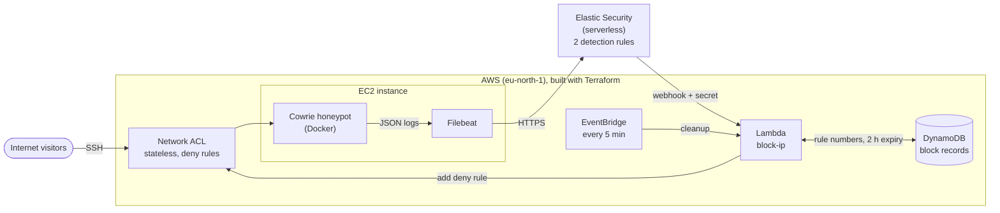
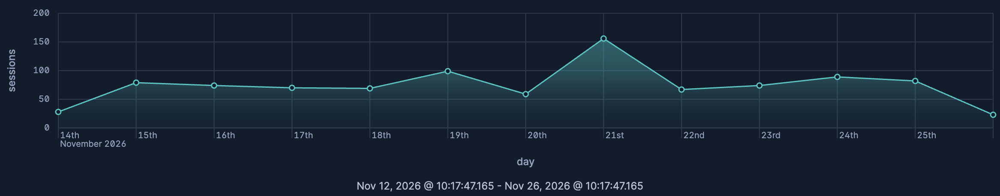
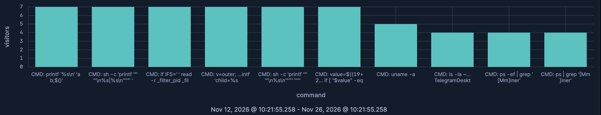

# Cloud honeypot with automated response

An SSH honeypot on AWS that logs attackers, detects bad behaviour in Elastic, and blocks the source address automatically.

## Architecture

## How it works

1. **Honeypot.** [Cowrie](https://github.com/cowrie/cowrie) runs in Docker on a small EC2 instance and pretends to be an SSH server. It accepts almost any login and records every command in a fake shell, but nothing a visitor does touches the real system. The image is pinned by digest, so the version cannot change silently.
2. **Log shipping.** Filebeat reads Cowrie's JSON log and sends it over HTTPS to an Elastic Security serverless project. Its API key is read from AWS Parameter Store at boot, so no secret is stored in the repo.
3. **Detection.** Two rules run in Elastic:
   - **Command burst:** 20 or more commands from one address within 5 minutes.
   - **Suspicious command:** a single command containing `nohup`, `chmod`, `wget` or `curl`, which is typical of installing malware.
4. **Response.** When a rule fires, Elastic calls a Lambda function over HTTPS. The Lambda checks a shared secret, then adds a deny rule for that address to the network ACL. DynamoDB hands out rule numbers (10 to 26) with conditional writes, so two simultaneous alerts cannot take the same number.
5. **Expiry.** Each block lasts 2 hours. A scheduled run every 5 minutes removes expired rules, so the ACL cannot fill up and block addresses forever.

Everything is defined in Terraform. Checkov scans it on every push through GitHub Actions.

## Results

Collected between 14 and 26 November 2026, with my own test addresses excluded.

| Measure | Value |
|---|---|
| Sessions | 969 |
| Distinct source addresses | 527 |
| Log events | 3,233 |
| Share of connections that ran a command (one automated client removed) | 5.1% |
| Real automated client blocked by the Lambda | 1 (confirmed in CloudTrail, expired after 2 h) |
| Delay from the 20th command to the block (5 controlled runs) | median 39.6 s, range 9.7 to 53.8 s |

Traffic was steady at about 60 to 100 sessions a day. The spike on 21 November was one address opening 87 sessions in about 95 seconds, which is the client the Lambda blocked.

Most connections never tried to log in. They are scanners.

Most commands test whether the shell is real, then fingerprint the machine.

Full write-up, including what the data does not show: [docs/analysis.md](docs/analysis.md).
