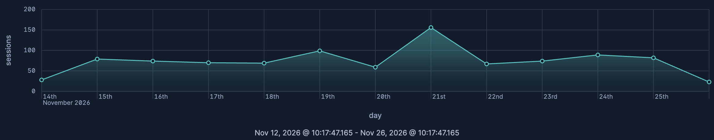
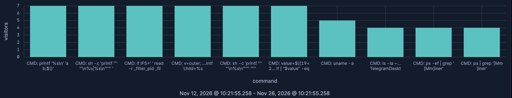

# What the honeypot saw

**Setup:** an internet-facing Cowrie SSH honeypot on AWS (eu-north-1), with logs shipped to Elastic.
**Window:** 14 November 2026 to 26 November 2026.

**Conventions**

- A _session_ is one SSH connection from open to close.
- Day buckets use Stockholm time (UTC+1).
- My own test addresses (home connection and phone hotspot) are excluded from every count. Visitor addresses are deliberately not published.
- Counts are lower bounds. They only include what was logged and shipped.

**Known gap:** a few hours of logs from 21 November are missing. The instance was replaced twice that day, once by an unplanned image update and once on purpose to add log shipping, and logs written between the two replacements were never shipped.

## 1. How much activity?

| Measure                   | Value |
| ------------------------- | ----- |
| Sessions                  | 969   |
| Distinct source addresses | 527   |
| Log events                | 3233  |

The numbers cover 14 to 26 November, with my own addresses excluded.

## 2. Is it steady?

Sessions per day (the first and last days are partial: collection started during the day on 14 November, and the data ends at about 10:30 on 26 November):

| Day    | Sessions | Distinct addresses |
| ------ | -------- | ------------------ |
| 14 Nov | 28       | 18                 |
| 15 Nov | 79       | 52                 |
| 16 Nov | 74       | 49                 |
| 17 Nov | 70       | 41                 |
| 18 Nov | 69       | 45                 |
| 19 Nov | 99       | 54                 |
| 20 Nov | 59       | 38                 |
| 21 Nov | 156      | 43                 |
| 22 Nov | 67       | 44                 |
| 23 Nov | 74       | 45                 |
| 24 Nov | 89       | 53                 |
| 25 Nov | 82       | 53                 |
| 26 Nov | 23       | 14                 |



Activity is steady at roughly 60 to 100 sessions a day from 40 to 55 addresses. 21 November stands out: 156 sessions but only 43 addresses. A single address made 87 of those sessions, in about 95 seconds.

## 3. How far did visitors get?

| Stage                    | All visitors | One automated client removed | Share of connections (client removed) |
| ------------------------ | ------------ | ---------------------------- | ------------------------------------- |
| Connected                | 969          | 882                          | 100%                                  |
| Logged in                | 142          | 57                           | 6.5%                                  |
| Ran at least one command | 130          | 45                           | 5.1%                                  |
| Uploaded a file          | 11           | 11                           | 1.2%                                  |

- About 85% of connections never tried to log in. They connect, announce their software version, and leave, which is what a port scanner does.
- Cowrie accepts almost any password, so "logged in" means "attempted a login", and it says nothing about skill.
- One automated client accounts for 85 of the 130 sessions that ran commands. Removing it shows that only about 1 in 20 connections goes beyond a login.

## 4. What did they run?



Commands counted by the number of distinct source addresses that used them (own traffic excluded, long commands truncated):

| Purpose                     | Examples                                                                        | Visitors per command |
| --------------------------- | ------------------------------------------------------------------------------- | -------------------- |
| Is this a real shell?       | quoting and variable-scope tests, `printf`, arithmetic expansion, a `read` loop | 7 each               |
| What machine is this?       | `uname -a`, CPU information                                                     | 5                    |
| Is a miner already running? | `ps` piped to `grep` for "miner"                                                | 4 each               |
| Is this a telecom device?   | listing Telegram data folders, GSM modem devices, SMS tools                     | 4                    |

Most commands are tests of how the shell behaves, followed by fingerprinting. The same six shell tests were run by seven addresses, which suggests a shared script, though the logs cannot confirm that.

## 5. Installers and uploaded files

- At least five addresses (about 1% of visitors) ran commands that fetch or start a program. Typical patterns: making a file executable and starting it in the background with a list of other machines as arguments, and a download command that tries three methods in turn.
- Files were uploaded in 11 sessions. All were named like the real SSH daemon, a camouflage trick. As of 23 November there were at least five distinct fingerprints, one fingerprint was uploaded by three different addresses, and one upload was an empty file (SHA-256 `e3b0c44298fc1c149afbf4c8996fb92427ae41e4649b934ca495991b7852b855`).
- The honeypot's firewall allows outbound traffic only on ports 80, 443 and 53. The download command used another port, and no log shows a program being fetched. That is consistent with the firewall working, but it is not proof.
- Uploaded files were never opened or run. Only their fingerprints were recorded.

## 6. What the system did about it

Two detection rules call a Lambda function, which adds a deny rule to the network ACL for the source address. Blocks expire after 2 hours.

| Rule                  | Fires on                                                         | Evidence                                                                                                               |
| --------------------- | ---------------------------------------------------------------- | ---------------------------------------------------------------------------------------------------------------------- |
| 1: command burst      | 20 or more commands from one address in 5 minutes                | Blocked one real automated client; 5 controlled test runs                                                              |
| 2: suspicious command | any single command containing `nohup`, `chmod`, `wget` or `curl` | Replay over past data matched the known events; one harmless test command; no real trigger seen at the time of writing |

**A real block.** On 21 November one address opened 87 sessions in about 95 seconds and ran a single shell-echo probe in each. The Lambda blocked it at 17:44:40 UTC, confirmed by AWS CloudTrail. The block expired and was removed by the scheduled cleanup at 19:48:45 UTC. The delay from the 20th command to the block was about 72 seconds (estimated from the command rate), slightly longer than the controlled runs. The cause is unknown.

**Controlled latency** (hotspot attacker, time from the 20th command to the Lambda starting):

| Run | Delay  |
| --- | ------ |
| 1   | 45.2 s |
| 2   | 17.6 s |
| 3   | 39.6 s |
| 4   | 9.7 s  |
| 5   | 53.8 s |

Range 9.7 to 53.8 s, median 39.6 s, n = 5. The spread comes from the detection rule running once a minute. The steps after the rule fires take about 2 seconds.

**A gap the data revealed.** Rule 1 would not have caught the quiet visitors who tried to install something, because they sent one or two commands each. Rule 2 was added to close that gap.

## What this does not show

- One honeypot, one region, about two weeks.
- Visitors are not classified. A scanner is not an attacker, and several addresses can belong to one operator.
- Whether visitors recognised the honeypot is unknown.
- The latency sample is small, from one attacker address, and clock differences of about a second were not corrected.
- Rule 2 has been replayed over past data and tested with a harmless command, but has not met a real installer.
- Rule 1 and rule 2 block by address, so an attacker who rotates addresses is only slowed down.

## How these numbers were produced

Each query ran in Kibana (ES|QL) over the shipped Cowrie logs. `<own addresses>` stands for my excluded test addresses.

```
-- how far visitors got
FROM filebeat-*
| WHERE NOT (src_ip IN (<own addresses>))
| STATS
    connected = COUNT_DISTINCT(session),
    logged_in = COUNT_DISTINCT(CASE(eventid == "cowrie.login.success", session)),
    ran_commands = COUNT_DISTINCT(CASE(eventid == "cowrie.command.input", session)),
    uploaded_file = COUNT_DISTINCT(CASE(eventid == "cowrie.session.file_upload", session))

-- sessions per day
FROM filebeat-*
| WHERE NOT (src_ip IN (<own addresses>))
| STATS sessions = COUNT_DISTINCT(session) BY day = DATE_TRUNC(1 day, @timestamp)
| SORT day

-- most common commands, by distinct visitors
FROM filebeat-*
| WHERE eventid == "cowrie.command.input"
  AND NOT (src_ip IN (<own addresses>))
  AND NOT (message LIKE "*nohup*")
| EVAL command = SUBSTRING(message, 1, 40)
| STATS visitors = COUNT_DISTINCT(src_ip) BY command
| SORT visitors DESC
| LIMIT 10
```

For the "one automated client removed" columns, that client's address was added to the exclusion list.
